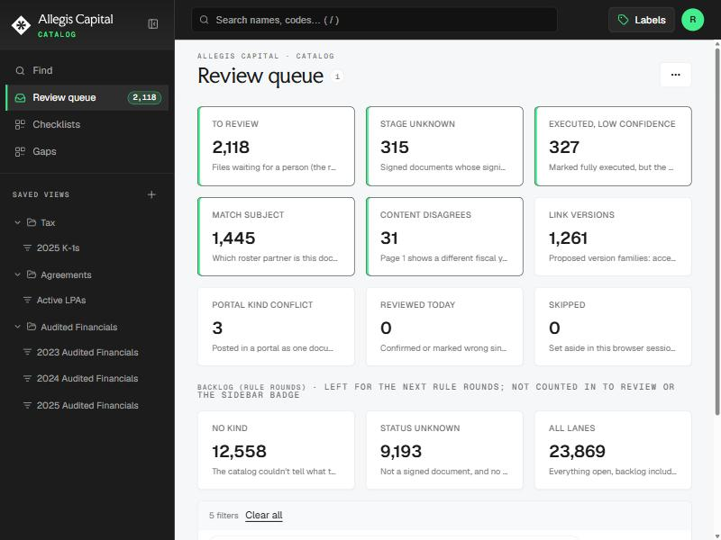

# CAT-WO-15 · Review queue split · dry run (throwaway)

2026-11-25 on throwaway `catwo15-throwaway` (`br-dark-leaf-bdnib6yp`, from main after CAT-WO-13). Main untouched. App and view change
only: no Drive or label writes, no rule / checklist / nightly change. Codes and counts only.

## Counts per lane (app.v_review_counts), before -> after migration 015

| Lane | Before | After | Counted in |
|---|---:|---:|---|
| Stage unknown | 315 | 315 | To review |
| Executed, low confidence | 327 | 327 | To review |
| Match subject | 1,445 | 1,445 | To review |
| Content disagrees | 31 | 31 | To review |
| No kind | 12,558 | 12,558 | Backlog (rule rounds) |
| Status unknown | 9,193 | 9,193 | Backlog (rule rounds) |
| **open_total** (all lanes) | 23,869 | 23,869 | "All lanes" card, in the backlog group |
| **review_total** (new) | - | **2,118** | headline "To review" + sidebar badge |

The lanes are unchanged (same view, same queue); only the new column and where the screen counts them changed.
`review_total` = 315 + 327 + 1,445 + 31 = 2,118. `catalog_app` can read the view (grant restated). Sidebar badge on the local
Worker: `/api/nav` -> `reviewOpen` 2,118 (was 23,869).

## Bulk Confirm on Match subject (R-023)

- Rows a bulk Confirm may take (exactly one roster candidate, no MULTIPLE / NOT_IN_FUND / CONFLICT_* / NO_ROSTER_MATCH reason, the
  code on the roster of the document's entities or issuer): **934** of 1,445 (972 have a single candidate; 38 of those fail the
  roster or reason check). At most 500 per action, so two actions would cover them.
- Writes go through the single-save Parties path (Subject code(s) via `subjectMods`, a `match_subject` review event with
  `{"subject_codes": [code], "bulk": true}`), after the user's live access check; no-access / secret files are skipped.
- Write-gated: on the local Worker with a session that has no write scope, `POST /api/review/subject-bulk` answers
  409 `consent_required` (no preview, no write). Nothing was confirmed in this dry run.

## Review screen (previews hidden)

Local Worker (`wrangler.local.jsonc`) on the throwaway, `?mask=1`, the list filtered to an empty set so no file name, preview or
Drive call appears. The session was minted locally with no Google token (`scripts/dev_proxy_nodrive.ts`); no token file was read.

Headline "To review" 2,118 and badge 2,118; "Backlog (rule rounds)" group with No kind 12,558, Status unknown 9,193 and All
lanes 23,869 (still browsable: a card filters the list to that lane).

## Tests

Type check clean. Vitest 171/171 (new `test/wo15.test.ts` 8; `review_list.test.ts` updated for the backlog group). The default
Review list now shows the four review lanes (a saved state with no lane still shows everything).

## Not changed

Rules, checklists, the nightly, labels. Migration 015 replaces only `app.v_review_counts` (appended column).
